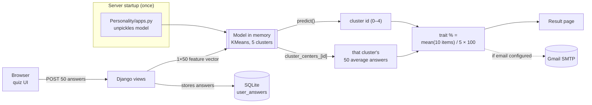

# Predicto

**Know Yourself** — a Big Five ("OCEAN") personality prediction web app. Users
register, answer a 50-question personality quiz, and a pre-trained ML model
assigns them a personality cluster and reports back scores across five traits.

Built with Python, Django, and scikit-learn. Data is stored in SQLite.

---

## Concept

Predicto is built around the **Big Five (OCEAN) personality model**, the most
widely used framework in personality psychology. Every user answers the same
50-item questionnaire (10 Likert-scale questions per trait, each rated 1–5,
e.g. *"I am the life of the party"*, *"I get stressed out easily"*), and the
app turns those 50 numbers into a percentage score for each trait:

| Trait | Code var | What it measures | Sample item |
|---|---|---|---|
| 🟠 **Extroversion** | `extroversion` | Energized by social interaction vs. solitude | "I am the life of the party." |
| 🔵 **Neuroticism** | `neurotic` | Emotional reactivity — worry, moodiness, stress sensitivity | "I get stressed out easily." |
| 🔴 **Agreeableness** | `agreeable` | Warmth, trust, and cooperation toward others | "I sympathize with others' feelings." |
| 🟢 **Conscientiousness** | `conscientious` | Organization, discipline, goal-directed behavior | "I like order." |
| 🟣 **Openness** | `openness` | Curiosity, imagination, appreciation for ideas | "I have a rich vocabulary." |

The user journey is a straight line:

**Register → Log in → Answer 50 questions → View & receive results**

---

## Architecture

Predicto is a classic server-rendered Django app — no separate API layer. The
ML model is loaded **once**, in memory, when the Django app starts, and every
request reuses that same in-memory model instead of reloading anything from
disk.



**Layers:**

- **Templates** (`predictor/templates/`) — plain HTML/CSS/jQuery for login,
  register, the 50-question quiz, and the result page.
- **Views** (`predictor/Personality/views.py`) — handles registration, login
  (session-based), storing quiz answers, and computing/rendering results.
- **Models** (`predictor/Personality/models.py`) — three Django ORM tables:
  `registration_details`, `user_answers`, `clusterNum`.
- **App config** (`predictor/Personality/apps.py`) — loads the pickled model
  from `ml/models/final_model.pkl` exactly once, at startup, so requests never
  pay the cost of reloading it.
- **Storage** — SQLite via the Django ORM.
- **Email** — optional: if SMTP credentials are configured, results are also
  emailed to the user via Gmail.

---

## The model

The model is a **scikit-learn `KMeans` clustering model** with `n_clusters=5`,
trained offline on ~1 million historical responses to the same 50-item
questionnaire (50 features in, 5 clusters out). It ships as a single artifact:
`ml/models/final_model.pkl`.

At prediction time, two things happen with **one** model and **one** call:

1. **`model.predict(vector)`** — takes the user's 50 answers and returns the
   id (0–4) of the nearest cluster centroid. This answers *"which personality
   cluster is this person closest to?"*
2. **`model.cluster_centers_[cluster_id]`** — a KMeans centroid is, by
   definition, the average of all 50 answer-features for everyone assigned to
   that cluster. So this single lookup gives the average questionnaire
   response for "people like this user" — no need to re-scan the original
   training dataset at request time.

Each trait's score is then just the mean of its 10 questions within that
centroid, rescaled from a 1–5 Likert scale to a 0–100% score:

```python
center = model.cluster_centers_[prediction[0]]
score  = round((center[trait_slice].mean() / 5) * 100, 2)
```

**Worked example** — a test user who answered every question with a neutral
"3" landed in a cluster with these trait scores:

| Extroversion | Neuroticism | Agreeableness | Conscientiousness | Openness |
|---|---|---|---|---|
| 58.21% | 50.45% | 57.06% | 58.30% | 62.41% |

In plain terms: the result isn't a direct psychological score for the
individual — it's *"the average trait profile of the group of past
respondents this user's answers most resemble."*

---

## Tech stack

`Python` · `Django 4.0.1` · `scikit-learn` (KMeans) · `SQLite` · `Gmail SMTP`

---

## Setup

1. Clone the repo and create a virtual environment:
   ```bash
   git clone https://github.com/cyber468/Predicto.git
   cd Predicto
   python3 -m venv venv
   source venv/bin/activate   # on Windows: venv\Scripts\activate
   ```

2. Install dependencies:
   ```bash
   pip install -r requirements.txt
   ```

3. (Optional) Configure secrets/email by copying `.env.example` to `.env` in
   the repo root and filling in values. Everything has a working local-dev
   default, so this step can be skipped to just try the app out — emailing
   results is simply skipped if `EMAIL_HOST_USER`/`EMAIL_HOST_PASSWORD` aren't set.
   ```bash
   cp .env.example .env
   ```

4. Run database migrations:
   ```bash
   cd predictor
   python manage.py migrate
   ```

5. Start the dev server:
   ```bash
   python manage.py runserver
   ```

6. Open http://127.0.0.1:8000/ in a browser, register an account, log in,
   and take the quiz.

## Repo layout

- `ml/models/` — pre-trained model artifacts used by the app.
- `predictor/` — the Django project (app code, templates, static files).
- `requirements.txt` — Python dependencies.
- `.env.example` — documents the environment variables the app reads.
