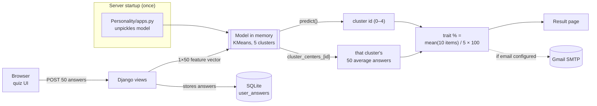

# Predicto

**Know Yourself** — a Big Five ("OCEAN") personality prediction web app. Users
register, answer a 50-question personality quiz, and a pre-trained ML model
assigns them a personality cluster and reports back scores across five traits.

Built with Python, Django, and scikit-learn. Data is stored in SQLite. The result page shows two profiles: the average
profile of people who answered like you (from the model) and your own answers scored with the published IPIP key.

---

## Concept

Predicto is built around the **Big Five (OCEAN) personality model**, the most
widely used framework in personality psychology. Every user answers the same
50-item questionnaire (10 Likert-scale questions per trait, each rated 1–5,
e.g. *"I am the life of the party"*, *"I get stressed out easily"*; the statements are the public-domain
[IPIP 50-item Big Five markers](https://ipip.ori.org/New_IPIP-50-item-scale.htm)), and the
app turns those 50 numbers into a percentage score for each trait:

| Trait | Code var | What it measures | Sample item |
|---|---|---|---|
| 🟠 **Extroversion** | `extroversion` | Energized by social interaction vs. solitude | "I am the life of the party." |
| 🔵 **Emotional stability** | `neurotic` | Calm and even-tempered vs. prone to worry and mood swings. A **high** score means calm. (The database field keeps its old name, `neurotic`.) | "I am relaxed most of the time." |
| 🔴 **Agreeableness** | `agreeable` | Warmth, trust, and cooperation toward others | "I sympathize with others' feelings." |
| 🟢 **Conscientiousness** | `conscientious` | Organization, discipline, goal-directed behavior | "I like order." |
| 🟣 **Openness** | `openness` | Curiosity, imagination, appreciation for ideas | "I have a rich vocabulary." |

The user journey is a straight line:

**Register → Log in → Answer 50 questions → View & receive results**

---

## Architecture

Predicto is a classic server-rendered Django app — no separate API layer. The
ML model is loaded **once**, in memory, when the Django app starts, and every
request reuses that same in-memory model instead of reloading anything from
disk.



**Layers:**

- **Templates** (`predictor/templates/`) — plain HTML/CSS/jQuery for login,
  register, the 50-question quiz, and the result page.
- **Views** (`predictor/Personality/views.py`) — handles registration, login
  (session-based), storing quiz answers, and computing/rendering results.
- **Models** (`predictor/Personality/models.py`) — three Django ORM tables:
  `registration_details`, `user_answers`, `clusterNum`.
- **App config** (`predictor/Personality/apps.py`) — loads the pickled model
  from `ml/models/final_model.pkl` exactly once, at startup, so requests never
  pay the cost of reloading it.
- **Storage** — SQLite via the Django ORM.
- **Email** — optional: if SMTP credentials are configured, results are also
  emailed to the user via Gmail.

---

## The model and the scoring

Two kinds of numbers are used, and they must not be mixed up:

- **Raw answers**: how much the person agreed with each statement, 1 (disagree) to 5 (agree). They are stored
  as-is in `user_answers` and are the only thing passed to the model.
- **Keyed scores**: raw answers with the 24 negatively worded statements flipped (`6 - x`), following the official
  IPIP key. Trait scores are averaged from these (`Personality/ml.py`, `Personality/questions.py`).

The model is a **scikit-learn `KMeans`** clustering model with `n_clusters=5`, trained offline on about one million
responses to the same 50 statements (the training data is not part of this repository). It ships as
`ml/models/final_model.pkl` and is trained on the **raw** scale.

At prediction time:

1. `model.predict(raw_answers)` returns the nearest cluster (0 to 4).
2. `model.cluster_centers_[cluster]` is that cluster's average raw answer to each statement. The key is applied to
   it and each trait's 10 items are averaged and rescaled to 0 to 100%. This is the **group profile**.
3. Your own trait scores use the same key on your own answers (the dashed outline on the result page).

```python
keyed = np.where(REVERSED, 6 - raw, raw)
score = round(keyed.reshape(5, 10).mean(axis=1) / 5 * 100, 2)
```

**Worked example**: answering every statement with a neutral "3" gives 60% on all five of your own scores (a 3 out
of 5, whichever way the statement is worded). That answer falls in cluster 4, whose group profile is:

| Extroversion | Emotional stability | Agreeableness | Conscientiousness | Openness |
|---|---|---|---|---|
| 51.26% | 71.75% | 58.06% | 64.32% | 74.12% |

A score is an average rating, not a percentile, and the group profile describes the people the model was trained on.
It is not a diagnosis. The result page explains this, with references (Goldberg 1992; Goldberg et al. 2006; Digman
1990; Roberts et al. 2007).

---

## Tech stack

`Python 3.9+` · `Django 4.2 LTS` · `scikit-learn 1.6.1` (KMeans) · `numpy` · `SQLite` · `Gmail SMTP` · `Playwright` (browser tests)

---

## Setup

1. Clone the repo and create a virtual environment:
   ```bash
   git clone https://github.com/cyber468/Predicto.git
   cd Predicto
   python3 -m venv .venv
   source .venv/bin/activate   # on Windows: .venv\Scripts\activate
   ```

2. Install dependencies:
   ```bash
   pip install -r requirements.txt
   ```

3. (Optional) Configure secrets/email by copying `.env.example` to `.env` in
   the repo root and filling in values. Everything has a working local-dev
   default for local development, so this step can be skipped to just try the app
   out. Emailing results is skipped if `EMAIL_HOST_USER`/`EMAIL_HOST_PASSWORD`
   aren't set. With `DJANGO_DEBUG=False` the app refuses to start without
   `DJANGO_SECRET_KEY`, and turns on secure cookies and an SSL redirect.
   ```bash
   cp .env.example .env
   ```

4. Run database migrations:
   ```bash
   cd predictor
   python manage.py migrate
   ```

5. Start the dev server:
   ```bash
   python manage.py runserver
   ```

6. Open http://127.0.0.1:8000/ in a browser, register an account, log in,
   and take the quiz.

## Tests

```bash
cd predictor
python manage.py test        # 23 Django tests: auth, validation, scoring key, model input, email
```

Browser test (needs Playwright and a server on port 8765, with a throwaway database):

```bash
pip install playwright && playwright install chromium
cd predictor
DJANGO_DB_PATH=/tmp/predicto_e2e.db python manage.py migrate
DJANGO_DB_PATH=/tmp/predicto_e2e.db python manage.py runserver 127.0.0.1:8765 &
cd .. && python e2e/test_flow.py
```

It registers, logs in, takes the quiz by keyboard, checks the result page (animation end state, references,
reduced motion, mobile width, no console errors), retakes the quiz and logs out. Screenshots go to `e2e/shots/`.

Note: `runserver --noreload` caches templates, so restart it after editing a template.

## Repo layout

- `ml/models/` — pre-trained model artifacts used by the app. `final_model.pkl` was saved with scikit-learn 0.24.2 and
  loads in 1.6.1 with a version warning; re-export it when you can.
- `predictor/` — the Django project.
  - `Personality/` — models, views, `ml.py` (model loading and scoring), `questions.py` (statements and IPIP key), tests.
  - `templates/`, `static/css/`, `static/js/` — the UI (quiz, animated result page).
- `e2e/test_flow.py` — Playwright browser test.
- `requirements.txt` — Python dependencies.
- `.env.example` — documents the environment variables the app reads (`DJANGO_DB_PATH` can also point the app at a different SQLite file).
- Existing accounts created before the rewrite keep working: plaintext passwords are upgraded to hashes on first login.
